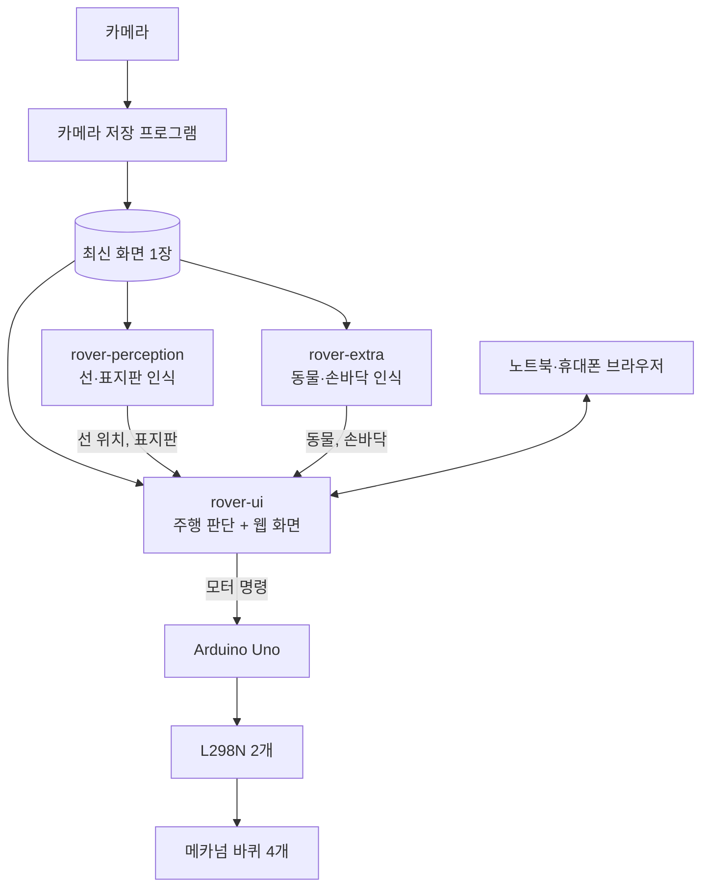

# tak 로버 설명서

메카넘 4륜 로버 "tak"을 웹 화면으로 조종하는 프로그램입니다.
자율 주행(선 추종, 표지판·동물 규칙), 손 추적, 수동 조종을 한 화면에서 합니다.

서버가 로버 안에서 돌기 때문에 **조종만 할 때는 노트북에 아무것도 설치하지 않습니다.** 브라우저만 있으면 됩니다.

## 목차

1. [한눈에 보기](#1-한눈에-보기)
2. [켜고 접속하기](#2-켜고-접속하기)
3. [화면 보는 법](#3-화면-보는-법)
4. [자율 주행](#4-자율-주행)
5. [손 추적](#5-손-추적)
6. [수동 조종](#6-수동-조종)
7. [시험 모드](#7-시험-모드)
8. [트랙에서 처음 맞추는 순서](#8-트랙에서-처음-맞추는-순서)
9. [코드를 고치고 로버에 올리기](#9-코드를-고치고-로버에-올리기)
10. [로버 안의 구성](#10-로버-안의-구성)
11. [하드웨어와 펌웨어](#11-하드웨어와-펌웨어)
12. [새로 설치할 때](#12-새로-설치할-때)
13. [다른 프로그램에서 쓰기](#13-다른-프로그램에서-쓰기)
14. [문제 해결](#14-문제-해결)
15. [확인된 것과 아직 못 본 것](#15-확인된-것과-아직-못-본-것)
16. [알려진 한계](#16-알려진-한계)

---

## 1. 한눈에 보기

### 부품

| 부품 | 내용 |
|---|---|
| 컴퓨터 | Raspberry Pi 4, Raspberry Pi OS (Debian 13) |
| 카메라 | CSI 카메라 OV5647, 640×480, 초당 12장 |
| 모터 제어 | Arduino Uno + HW-095(L298N) 2개 |
| 바퀴 | 메카넘 4개 (게걸음 가능) |
| 없는 것 | 엔코더, 초음파, 자이로. 회전은 시간으로 맞추고, 장애물 앞에서 멈추는 센서는 없습니다 |

### 구조



### 로버에서 도는 프로그램 3개

| 서비스 | 하는 일 | 코드 |
|---|---|---|
| `rover-perception` | 카메라를 읽고 선과 표지판을 인식 | 로버에 원래 있던 `~/robot_ws` (이 저장소에 없음) |
| `rover-extra` | 동물과 손바닥을 인식 | `rover_animals/rover_extra.py` |
| `rover-ui` | 주행 판단, 아두이노 통신, 웹 화면 (포트 8000) | `rover_ui/rover_ui.py`, `rover_ui/index.html` |

세 서비스는 로버 전원을 켜면 스스로 시작합니다.

---

## 2. 켜고 접속하기

1. 로버 전원을 켭니다. 서비스가 뜰 때까지 1~2분 기다립니다.
2. 노트북이나 휴대폰을 로버와 같은 와이파이(캠퍼스 `robot` 또는 `robot-5G`)에 연결합니다.
3. 브라우저에서 `http://172.30.1.162:8000` 을 엽니다.
4. 접속 번호 4자리를 넣습니다. 같은 브라우저에서는 30일 동안 다시 묻지 않습니다.

### 접속 번호

- 같은 와이파이에 있는 아무나 로버를 움직이지 못하게 하려고 둔 번호입니다.
- 번호는 로버의 `~/rover_ui/pin.txt` 에 있습니다. 로버에 접속해서 봅니다.

  ```bash
  ssh takyeji@172.30.1.162 "cat ~/rover_ui/pin.txt"
  ```

- `./deploy.sh` 를 실행하면 끝에 번호를 보여 줍니다.
- 1분 안에 8번 틀리면 그 기기는 최대 1분 동안 막힙니다.
- 번호를 바꾸려면 `pin.txt` 내용을 고치고, 번호 없이 쓰려면 `off` 라고 적은 뒤 UI 서비스를 다시 시작합니다.

  ```bash
  systemctl --user restart rover-ui.service
  ```

### 주소가 바뀌었을 때

로버 주소는 와이파이가 정해 주므로 바뀔 수 있습니다. 화면이 안 열리면 로버에 모니터를 연결하거나 다른 방법으로 들어가 주소를 확인합니다.

```bash
hostname -I
```

---

## 3. 화면 보는 법

### 맨 위 표시등

| 표시 | 초록 | 빨강 |
|---|---|---|
| 카메라 | 화면이 2초 안에 새로 들어옴 | 카메라 화면이 멈춤 |
| 선·표지판 인식 | 인식 결과가 1초 안에 갱신됨 | 인식 프로그램이 응답하지 않음 |
| 동물 인식 / 손바닥 인식 | 보조 인식기가 3초 안에 응답 (손 추적 탭에서는 손바닥으로 바뀜) | 보조 인식기가 멈춤 |
| 아두이노 | 모터 보드와 연결됨 | 연결 안 됨. 주황색 "모터 꺼짐"은 시험 모드 |
| 온도 | 75°C 미만 | 80°C 이상 (75~80°C는 주황) |

로버를 켠 직후 20~30초는 인식 모델을 읽는 중이라 빨갛게 나올 수 있습니다. 초록으로 바뀐 뒤 시작합니다.

### 영상 위의 표시

글씨는 영상에 그리지 않고 브라우저가 따로 그리므로 확대해도 깨지지 않습니다.

| 색 | 뜻 |
|---|---|
| 빨간 박스 | STOP 표지판, 유턴 금지 표지판 |
| 주황 박스 | 피해 갈 표지판 (주의, 진입 금지) |
| 보라 박스 | 파란 유턴 표지판 |
| 초록 박스 | 동물 |
| 파란 박스 | 손바닥 |
| 노란 세로 막대 | 로버가 보고 있는 선의 좌우 위치 |
| 하늘색 점선 | 로버가 본 벽의 밑단 (왼쪽·가운데·오른쪽 세 구역) |
| 점선 박스 | 확신도가 기준보다 낮거나 화면 옆·아래 끝에 걸려서 주행에 쓰지 않는 인식 |
| 박스가 빛남 | 주행이 반응하는 표지판 (STOP은 보이는 즉시, 다른 표지판은 가까울 때) |

### 상태 줄과 기록

- 큰 글씨가 지금 하는 일입니다 (예: "선을 따라가는 중", "벽에 붙는 중").
- 그 아래 주황 글씨는 멈춘 이유입니다 (예: "STOP 표지판이 보여 자율 주행을 끝냈습니다").
- 아래쪽 표는 선·표지판·앞 벽·동물 인식값과 지금 보내는 모터 명령입니다. 값을 맞출 때 이 숫자를 봅니다.
- `기록`에는 시작, 정지, 회전한 이유가 시각과 함께 남습니다.

### 멈추는 방법

- 오른쪽 위 빨간 `정지` 버튼
- 키보드 스페이스 바 또는 Esc
- 다른 탭으로 옮기기 (주행 중이면 멈춥니다)

브라우저를 닫아도 자율 주행은 계속됩니다. 멈추려면 위 방법을 써야 합니다.

---

## 4. 자율 주행

`자율 주행 시작`을 누르면 노란 가운데 선을 따라갑니다.

### 4.1 동작 순서

1. 선이 보일 때까지 제자리에서 기다립니다.
2. 선이 보이면 선이 화면 가운데에 오도록 좌우 바퀴 속도를 조절하며 갑니다. 선이 많이 치우치면 속도를 줄입니다.
3. 가까운 표지판이나 동물이 있으면 [4.3](#43-표지판), [4.4](#44-동물)의 규칙을 따릅니다.
4. 선이 안 보이면 [4.2](#42-선이-안-보일-때-코너)의 방법으로 코너를 돕니다.
5. 카메라 인식이 끊기면 바로 멈추고, 3초 넘게 끊기면 주행을 끝냅니다.

### 4.2 선이 안 보일 때 (코너)

카메라가 앞쪽만 보기 때문에 코너에서는 선이 일찍 화면에서 사라집니다. 그래서 벽을 기준으로 삼습니다.

1. 선이 안 보이면 돌지 않고 **그대로 직진**합니다 (속도는 주행 속도의 80%).
2. 카메라 화면이 벽으로 85% 이상 가려지면 벽 앞이라고 판단합니다.
3. `벽이 화면을 가린 뒤 더 가는 시간`만큼 더 가서 벽에 붙습니다.
4. `90도 도는 시간`만큼 **제자리에서 회전**합니다.
5. 다시 직진하다가 선이 4번 연속 보이면 선을 따라갑니다.

도는 방향은 다음 순서로 정합니다.

1. 벽에 다가가는 동안 화면 왼쪽과 오른쪽 중 벽이 더 멀리 보인 쪽 (열린 쪽)
2. 그것으로 알 수 없으면 선이 사라진 쪽
3. 그것도 없으면 `도는 방향을 모를 때` 설정

예외 처리는 이렇습니다.

| 상황 | 동작 |
|---|---|
| 갈림길에서 선이 잠깐 끊겼다 다시 보임 | 그대로 직진해서 선을 따라감 |
| 돌자마자 코앞이 벽 | 닫힌 쪽으로 돈 것이므로 반대로 180도 회전 |
| 2.5초 직진해도 벽이 안 보임 | 그 자리에서 90도 회전 |
| 벽에서 4번 돌아도 선을 못 찾음 | 주행을 끝냄 |

`선이 안 보이면`을 `제자리에서 찾기`로 바꾸면 예전 방식(조금 더 직진한 뒤 제자리에서 돌며 선 찾기)으로 돌아갑니다. 벽이 없는 연습 매트에서는 이쪽을 씁니다.

### 4.3 표지판

표지판 인식 모델이 아는 것은 다섯 가지입니다.

| 화면 이름 | 실제 모양 | 자율 주행에서 | 손 추적에서 |
|---|---|---|---|
| STOP | 빨간 팔각형 STOP | **보이면 바로 주행을 끝냄** | 보이면 멈춤 |
| 주의 | 노란 삼각형 | 그 길로 가지 않고 다른 선을 찾음 | 반응 없음 |
| 진입 금지 | 빨간 팔각형 손바닥 | 그 길로 가지 않고 다른 선을 찾음 | 반응 없음 |
| 진입 금지 | 빨간 원에 흰 가로줄 | 그 길로 가지 않고 다른 선을 찾음 | 반응 없음 |
| 유턴 | 파란 원 유턴 화살표 | 무시 (설정에서 180도 회전으로 바꿀 수 있음) | 왼쪽으로 180도 회전 |
| 유턴 금지 | 빨간 테두리와 사선이 있는 유턴 화살표 | 그 길로 가지 않고 다른 선을 찾음 | 멈춤 |

- **STOP의 기준:** STOP은 가까워질 때까지 기다리지 않고, 보이면 바로 자율 주행을 끝냅니다. 확신도 50% 이상, 박스 높이가 화면 높이의 5% 이상이고, 최근 인식 4번 중 2번 이상에서 보일 때입니다. 다른 선을 찾아 돌거나 벽에서 도는 중에도 같습니다.
- **다른 표지판에서 "가깝다"의 기준:** 표지판 높이가 화면 높이의 25% 이상, 확신도 75% 이상, 인식 결과가 2번 연속일 때입니다.
- **화면 끝에 걸린 표지판:** 옆이나 아래 끝에 걸린 박스는 세지 않습니다. 위쪽 끝에만 걸리고 절반 넘게 보이면 셉니다. 로버가 다가가면 표지판이 화면 위로 빠져나가기 때문입니다.
- **다른 선을 찾는 방법:** 표지판이 보이는 쪽의 반대로 제자리에서 돕니다. 정면이면 `도는 방향을 모를 때` 쪽으로 돕니다. 1.2초 이상 돈 뒤 선이 보이고 가까운 표지판이 없으면 그 선을 따라갑니다. 6초 안에 못 찾으면 주행을 끝냅니다.
- **유턴 금지:** 모델에는 이 종류가 없어서 "유턴"으로 읽습니다. 그래서 박스 안이 파랗지 않고 빨가면 유턴 금지로 바꿔 판단합니다.
- **잘못 인식하는 경우:** 모델이 크고 빨간 물체(예: 빨간 의자)를 STOP으로 읽을 때가 있습니다. 화면 표에 이름과 확신도가 나오니, 이유 없이 주행이 끝나면 무엇을 봤는지 확인하고 `STOP 확신도 기준`이나 `STOP을 인정하는 최소 크기`를 올립니다.

### 4.4 동물

동물 모형은 종류와 관계없이 모두 "동물"로 표시합니다.

- 반응 조건: 화면 가운데 쪽에 있고, 발이 화면 아래쪽 절반에 닿아 있으며, 박스 높이가 화면의 16% 이상일 때
- 동물 인식은 1초에 한 번 정도라서, 처음 보이면 **일단 멈추고 한 번 더 확인**합니다.
- 두 번 연속 보이면 표지판과 같은 방법으로 반대쪽으로 돌아 다른 선을 찾습니다.
- 옆이나 멀리 있는 동물은 표시만 하고 반응하지 않습니다.

### 4.5 설정

값을 바꾸면 바로 적용되고 로버에 저장됩니다.

| 항목 | 기본값 | 뜻 |
|---|---|---|
| 주행 속도 | 150 | 직진할 때 모터 세기 (0~255) |
| 선이 안 보이면 | 벽까지 직진 후 90도 | 코너 도는 방식. `제자리에서 찾기`는 예전 방식 |
| 90도 도는 시간 | 1.2초 | 벽에서 제자리 회전하는 시간. 덜 돌면 늘리고 더 돌면 줄임 |
| 벽이 화면을 가린 뒤 더 가는 시간 | 1.0초 | 벽 앞에서 더 미는 시간. 벽에 닿기 전에 돌면 늘림 |
| 도는 방향을 모를 때 | 오른쪽 | 방향을 알 수 없을 때 쓰는 쪽 |
| 표지판 규칙 | 켬 | 끄면 표지판을 표시만 하고 반응하지 않음 |
| STOP 표지판이 보이면 | 주행 종료 | `무시`로 바꾸면 지나감 |
| STOP 확신도 기준 | 50% | STOP 박스의 확신도가 이 이상이면 종료. 엉뚱한 물체에 끝나면 올림 |
| STOP을 인정하는 최소 크기 | 5% | 박스 높이가 화면의 이 비율 이상이면 종료. 너무 멀리서 끝나면 올림 |
| 파란 유턴 표지판이 가까우면 | 무시 | `180도 회전`으로 바꿀 수 있음 |
| 길에 동물이 보이면 | 다른 길로 | `기다림`은 동물이 치워질 때까지 정지, `무시`는 반응 없음 |
| 동물을 가깝다고 보는 크기 | 16% | 작게 하면 더 멀리서 반응 |
| 다른 표지판을 가깝다고 보는 크기 | 25% | STOP이 아닌 표지판에 적용. 작게 하면 더 멀리서 반응 |
| 다른 표지판 확신도 기준 | 75% | 이보다 낮은 인식은 점선으로만 표시 |

### 4.6 세부 조정

`세부 조정`을 펼치면 나옵니다. 보통은 건드리지 않습니다.

| 항목 | 기본값 | 뜻 |
|---|---|---|
| 조향 세기 (kp) | 1.6 | 선이 치우친 만큼 꺾는 세기. 좌우로 흔들리면 줄임 |
| 치우침 보정 (ki) | 0.6 | 한쪽으로 계속 치우칠 때 서서히 바로잡는 세기 |
| 조향 한계 | 0.4 | 좌우 바퀴 속도 차이의 최대 비율 |
| 제자리 회전 세기 | 220 | 회전할 때 모터 세기. 140 정도로는 거의 돌지 않음 |
| 벽이 안 보여도 직진하는 최대 시간 | 2.5초 | 이 시간이 지나면 벽이 안 보여도 회전 |
| 벽으로 보는 화면 가림 비율 | 85% | 가운데 화면이 이만큼 가려지면 벽 앞으로 판단 |
| (제자리에서 찾기) 선이 끊긴 뒤 더 직진하는 시간 | 0.5초 | 예전 방식에서만 사용 |
| (제자리에서 찾기) 선을 찾아 도는 시간 | 3.5초 | 예전 방식에서만 사용 |
| 우회할 때 최소 회전 시간 | 1.2초 | 표지판·동물을 피할 때 최소한 도는 시간 |
| 우회로를 찾는 최대 시간 | 6초 | 넘으면 주행을 끝냄 |
| 선 확신도 기준 | 50% | 이보다 낮으면 선이 안 보이는 것으로 판단 |

---

## 5. 손 추적

`손 추적` 탭에서 `손 추적 시작`을 누릅니다.

1. 카메라 앞에 손바닥을 펴서 보여 줍니다.
2. 손이 화면 옆쪽에 있으면 그쪽으로 짧게 돌고, 멈춘 뒤 다시 확인합니다. 손바닥 인식이 화면 1장에 0.25~0.5초 걸려서 조금씩 끊어서 돕니다.
3. 손이 가운데 쪽에 있으면 다가갑니다.
4. 손바닥이 화면의 7.5% 이상을 차지하면 도착으로 보고 멈춥니다. 손이 멀어지면 다시 따라갑니다.
5. 손이 0.7초 넘게 안 보이면 제자리에서 기다립니다.

손 추적 중의 표지판 반응은 이렇습니다.

| 표지판 | 동작 |
|---|---|
| 파란 유턴 | 왼쪽으로 180도 돈 뒤, 손이 다시 보이면 이어서 따라감 |
| 유턴 금지 | 멈추고 손 추적을 끝냄 |
| STOP (박스 높이가 화면의 10% 이상으로 보일 때) | 멈추고 손 추적을 끝냄 |

| 항목 | 기본값 | 뜻 |
|---|---|---|
| 다가오는 속도 | 130 | 손 쪽으로 갈 때 모터 세기 |
| 멈추는 손 크기 | 7.5% | 클수록 더 가까이 옴 |
| 손 쪽으로 도는 세기 | 200 | 회전할 때 모터 세기 |
| 유턴 표지판에서 180도 도는 시간 | 2.4초 | 덜 돌면 늘리고 더 돌면 줄임 |

---

## 6. 수동 조종

`수동 조종` 탭에서 버튼이나 키보드를 **누르고 있는 동안만** 움직입니다. 손을 떼면 0.5초 안에 멈춥니다.

| 키 | 동작 |
|---|---|
| W / S | 전진 / 후진 |
| A / D | 제자리 좌회전 / 우회전 |
| Q / E | 왼쪽 / 오른쪽 게걸음 |
| 스페이스 | 정지 |

| 항목 | 기본값 |
|---|---|
| 전진·후진 세기 | 150 |
| 회전 세기 | 220 |
| 게걸음 세기 | 200 |

### 기록한 주행 재생

`기록한 주행 재생`에서 파일을 고르고 `재생`을 누르면, 예전에 수동으로 조종한 명령을 같은 시간 간격으로 다시 보냅니다.
엔코더가 없어서 위치를 보정하지 못하므로, 출발 위치와 방향이 기록할 때와 같아야 하고 갈수록 어긋납니다.
기록 파일은 로버의 `~/rover_runs/` 에 있습니다. 새로 기록하려면 [11.4](#114-명령줄-도구)의 `teleop`을 씁니다.

---

## 7. 시험 모드

화면 아래쪽 `모터 출력`을 `끔`으로 두면 판단은 그대로 하되 **바퀴는 돌지 않습니다.** 표의 "모터 명령"에 보내려던 명령이 나옵니다.

- 책상 위에서 표지판이나 손 인식을 확인할 때 씁니다.
- 주행 중에 `켬`으로 바꾸면 갑자기 움직이지 않도록 주행이 멈춥니다. `시작`을 다시 눌러야 합니다.
- 로버를 껐다 켜면 항상 `켬`으로 돌아옵니다.

---

## 8. 트랙에서 처음 맞추는 순서

회전을 시간으로 맞추기 때문에, 바닥이나 배터리 상태가 달라지면 값을 다시 맞춰야 합니다.

1. **바퀴 확인:** 수동 조종에서 W, A, Q를 짧게 눌러 전진, 좌회전, 왼쪽 게걸음이 맞는지 봅니다.
2. **90도 회전:** 자율 주행에서 벽에 닿은 뒤 도는 각도를 보고 `90도 도는 시간`을 맞춥니다. 이때 회전은 세부 조정의 `제자리 회전 세기`(220)로 돕니다.
3. **벽 접근:** 벽에 닿기 전에 돌면 `벽이 화면을 가린 뒤 더 가는 시간`을 늘리고, 벽을 오래 밀면 줄입니다. 표의 "앞 벽"에서 화면 가림 값이 벽 앞에서 85%를 넘는지 봅니다.
4. **직선 추종:** 좌우로 흔들리면 `조향 세기`를 줄이고, 한쪽으로 치우쳐 가면 `치우침 보정`을 올립니다.
5. **표지판 거리:** 표지판을 세워 두고 표의 "크기" 숫자를 보면서 `다른 표지판을 가깝다고 보는 크기`를 정합니다. STOP이 너무 멀리서 주행을 끝내면 `STOP을 인정하는 최소 크기`를 올립니다.
6. **유턴:** 손 추적에서 파란 유턴 표지판을 보여 주고 `180도 도는 시간`을 맞춥니다.

---

## 9. 코드를 고치고 로버에 올리기

### 9.1 받기

```bash
git clone https://github.com/SLA3DP/tak-rover.git
cd tak-rover
```

### 9.2 폴더

| 경로 | 내용 |
|---|---|
| `rover_ui/rover_ui.py` | 제어 서버. 주행 판단, 아두이노 통신, 웹 서버 |
| `rover_ui/index.html` | 화면 |
| `rover_ui/rover.sh` | 로버에서 서비스를 관리하는 스크립트 |
| `rover_ui/systemd/` | 서비스 파일 3개 |
| `rover_animals/rover_extra.py` | 동물·손바닥 인식기 (도커 안에서 실행) |
| `firmware/rover_uno_l298/` | 아두이노 펌웨어 (`.ino` 원본, `.hex` 올리는 파일) |
| `tools/uno_flash.py` | 로버에서 아두이노에 펌웨어를 올리는 도구 |
| `tools/rover_uno_drive.py` | 명령줄 주행 도구 (바퀴 확인, 수동 조종 기록 등) |
| `pi_config/` | 대회장 조명에 맞춘 인식 설정 |
| `runs/` | 수동 조종으로 기록한 코스 주행 |
| `deploy.sh` | 노트북에서 로버로 올리는 스크립트 |
| `CLAUDE.md` | Claude Code로 이어서 작업할 때 읽는 맥락 |

### 9.3 로버에 올리기

로버가 달리는 중이면 먼저 멈춥니다. 올리면 UI 서비스가 다시 시작됩니다.

```bash
./deploy.sh
```

주소가 다르면 뒤에 적습니다.

```bash
./deploy.sh takyeji@172.30.1.162
```

스크립트가 하는 일은 이렇습니다.

1. 로버에 접속합니다 (비밀번호를 한 번 묻습니다).
2. `rover_ui/`, `rover_animals/rover_extra.py`, `tools/` 의 파일을 올립니다.
3. `pi_config/` 의 설정은 로버에 없을 때만 올립니다. 현장에서 고친 값을 덮어쓰지 않기 위해서입니다.
4. 서비스를 등록하고 `rover-ui`, `rover-extra` 를 다시 시작합니다.
5. 서비스 상태와 접속 번호를 보여 줍니다.

`deploy.sh` 는 macOS, Linux, WSL용입니다. Windows 명령 프롬프트에서는 직접 올립니다 (명령마다 비밀번호를 묻습니다).

```bash
scp rover_ui/rover_ui.py rover_ui/index.html rover_ui/rover.sh takyeji@172.30.1.162:rover_ui/
scp rover_animals/rover_extra.py takyeji@172.30.1.162:rover_animals/
ssh takyeji@172.30.1.162 "systemctl --user restart rover-ui.service rover-extra.service"
```

- 화면(`index.html`)만 고쳤으면 서비스를 다시 시작하지 않아도 됩니다. 올린 뒤 브라우저를 새로 고칩니다.
- 설정 기본값을 코드에서 바꿔도, 로버에 저장된 값(`~/rover_ui/params.json`)이 있으면 그 값이 우선합니다.

### 9.4 GitHub에 다시 올리기

저장소에 쓸 수 있는 계정으로 로그인한 뒤 올립니다.

```bash
gh auth login
git add -A
git commit -m "무엇을 왜 고쳤는지"
git push
```

### 9.5 Claude Code로 이어서 작업하기

받은 폴더에서 Claude Code를 시작합니다. 배선, 정해 둔 규칙, 표지판 종류, 확인된 것과 안 된 것이 `CLAUDE.md` 에 있어서 새 대화에서도 이어집니다.
Claude는 비밀번호를 입력하지 못하므로 로버 비밀번호는 터미널에 직접 입력합니다.

---

## 10. 로버 안의 구성

### 10.1 서비스 관리

로버에 접속해서 실행합니다.

```bash
~/rover_ui/rover.sh status                 # 상태
~/rover_ui/rover.sh restart                # 모두 다시 시작
~/rover_ui/rover.sh stop                   # 모두 끄기
~/rover_ui/rover.sh start                  # 다시 켜기
~/rover_ui/rover.sh logs ui 80             # 기록 80줄 (ui | extra | perception)
~/rover_ui/rover.sh disable                # 전원을 켤 때 자동 시작하지 않게
~/rover_ui/rover.sh enable                 # 자동 시작 다시 켜기
~/rover_ui/rover.sh install                # 서비스 파일을 다시 등록
```

하나만 다시 시작할 때는 이렇게 합니다.

```bash
systemctl --user restart rover-ui.service
```

기록을 직접 볼 때는 `--user-unit` 을 씁니다 (`journalctl --user` 로는 나오지 않습니다).

```bash
journalctl --no-pager -n 50 --user-unit rover-ui.service
```

### 10.2 파일 위치

| 경로 (로버) | 내용 |
|---|---|
| `~/rover_ui/` | 제어 서버, 화면, 관리 스크립트 |
| `~/rover_ui/pin.txt` | 접속 번호 |
| `~/rover_ui/params.json` | 화면에서 바꾼 설정값 |
| `~/rover_animals/rover_extra.py` | 동물·손바닥 인식기 |
| `~/rover_animals/yolo11n_coco.pt` | 동물 인식 모델 |
| `~/rover_animals/out/extra.json` | 동물·손바닥 인식 결과 |
| `~/robot_ws/` | 선·표지판 인식 코드 (원래 있던 것) |
| `~/robot_ws/.runtime/latest.jpg` | 카메라의 최신 화면 |
| `~/robot_ws/.runtime/venue_yolo.yaml` | 지금 쓰는 인식 설정 (노란색 범위, 표지판 모델) |
| `~/robot_ws/models/sign_yolo11n_20261119_ncnn_model` | 표지판 인식 모델 |
| `~/rover_runs/` | 수동 조종 기록 |
| `~/.config/systemd/user/rover-*.service` | 등록된 서비스 파일 |

### 10.3 스스로 복구하는 것

- 서비스가 죽으면 2~5초 뒤 다시 시작합니다.
- 카메라 화면이 8초 넘게 멈추면 `rover-ui` 가 인식 서비스를 다시 시작합니다. 충격이나 전압 저하 뒤에 카메라가 멈춘 적이 있어서 넣었습니다.
- 아두이노 연결이 끊기면 3초마다 다시 연결을 시도합니다.
- 펌웨어는 명령이 0.3초 끊기면 스스로 모터를 멈춥니다. 서버가 죽어도 바퀴가 계속 돌지 않습니다.

---

## 11. 하드웨어와 펌웨어

### 11.1 배선

| L298N 보드 | IN1 | IN2 | IN3 | IN4 |
|---|---|---|---|---|
| 왼쪽 | D11 | D10 | D9 | D8 |
| 오른쪽 | D2 | D3 | D4 | D5 |

ENA, ENB는 점퍼를 꽂아 둔 상태로 씁니다. 아두이노는 USB로 Pi에 연결합니다 (`/dev/ttyACM0`).

### 11.2 모터 번호

| 번호 | 바퀴 | 연결 |
|---|---|---|
| 0 | 왼쪽 뒤 | 왼쪽 보드 IN1/IN2 |
| 1 | 왼쪽 앞 | 왼쪽 보드 IN3/IN4 |
| 2 | 오른쪽 앞 | 오른쪽 보드 IN1/IN2 |
| 3 | 오른쪽 뒤 | 오른쪽 보드 IN3/IN4 |

배선 방향 때문에 왼쪽 두 바퀴는 반대로 돌아서, 방향 부호 `-1 -1 1 1` 을 아두이노에 저장해 두었습니다. 그래서 모든 바퀴에서 + 가 전진입니다.

### 11.3 펌웨어 명령

속도 115200. 켜지면 `L298 READY` 를 보냅니다.

| 명령 | 뜻 |
|---|---|
| `M 왼 오` | 왼쪽 두 바퀴, 오른쪽 두 바퀴의 세기 (−255~255) |
| `W a b c d` | 모터 0~3 각각의 세기 (게걸음에 사용) |
| `S` | 정지 |
| `D a b c d` | 모터 0~3 의 방향 부호(+1/−1)를 저장 |
| `?` | 현재 상태 |

### 11.4 명령줄 도구

`rover-ui` 가 아두이노를 잡고 있으므로, 먼저 UI 서비스를 멈춥니다. 끝나면 다시 켭니다.

```bash
systemctl --user stop rover-ui.service
```

바퀴를 띄워 놓고 하나씩 돌려 방향을 확인합니다.

```bash
python3 ~/rover_uno_drive.py wheels
```

방향 부호를 다시 저장합니다.

```bash
python3 ~/rover_uno_drive.py dir -1 -1 1 1
```

수동으로 조종하면서 기록합니다 (`x` 를 누르면 `~/rover_runs/` 에 저장).

```bash
python3 ~/rover_uno_drive.py teleop
```

```bash
systemctl --user start rover-ui.service
```

### 11.5 펌웨어 올리기

로버에는 아두이노 개발 도구가 없어서 두 단계로 합니다.

1. 노트북에서 `.ino` 를 고쳤으면 hex 파일을 다시 만듭니다 (`arduino-cli` 와 `arduino:avr` 코어 필요). 고치지 않았으면 저장소의 hex를 그대로 씁니다.

   ```bash
   arduino-cli compile -b arduino:avr:uno --output-dir build firmware/rover_uno_l298
   ```

   ```bash
   cp build/rover_uno_l298.ino.hex firmware/rover_uno_l298/rover_uno_l298.hex
   ```

2. hex 파일을 로버로 보내고, 로버에서 올립니다.

   ```bash
   scp firmware/rover_uno_l298/rover_uno_l298.hex takyeji@172.30.1.162:
   ```

   ```bash
   systemctl --user stop rover-ui.service && python3 ~/uno_flash.py upload ~/rover_uno_l298.hex && systemctl --user start rover-ui.service
   ```

올리기 전에 지금 들어 있는 프로그램을 받아 두려면 `python3 ~/uno_flash.py dump backup.bin`, 되돌리려면 `restore backup.bin` 을 씁니다.

---

## 12. 새로 설치할 때

SD 카드를 새로 만들었거나 다른 로버에 넣을 때입니다. 이 저장소만으로는 안 되고, 아래가 로버에 먼저 있어야 합니다.

| 필요한 것 | 설명 |
|---|---|
| `~/robot_ws` | 선·표지판 인식 코드. 빌드되어 있어야 함 (`install/setup.bash`) |
| 도커 이미지 `rover-jazzy:ncnn` | ROS 2, OpenCV, Ultralytics가 들어 있는 이미지 |
| 표지판 모델 | `~/robot_ws/models/sign_yolo11n_20261119_ncnn_model` |
| 동물 모델 | Ultralytics의 YOLO11n 기본 모델(`yolo11n.pt`)을 `~/rover_animals/yolo11n_coco.pt` 로 저장 |
| 호스트 파이썬 | pyserial, numpy, Pillow. 없으면 `sudo apt install python3-serial python3-numpy python3-pil` |
| 계정 | `docker`, `dialout`, `video` 그룹에 속해야 함 |

그 다음 순서입니다.

1. 전원을 켤 때 로그인 없이 서비스가 뜨게 합니다 (로버에서 한 번, 관리자 비밀번호 필요).

   ```bash
   sudo loginctl enable-linger takyeji
   ```

2. 노트북에서 코드를 올립니다. 서비스 등록까지 됩니다.

   ```bash
   ./deploy.sh
   ```

3. 아두이노에 펌웨어를 올리고 ([11.5](#115-펌웨어-올리기)), 바퀴 방향을 확인합니다 ([11.4](#114-명령줄-도구)).
4. 브라우저로 접속해 표시등이 모두 초록인지 봅니다.

조명이 다른 곳에서는 노란 선이 안 잡힐 수 있습니다. 그때는 `~/robot_ws/.runtime/venue_yolo.yaml` 의 `hsv_low`, `hsv_high` 를 고치고 인식 서비스를 다시 시작합니다. 지금 값은 대회장 조명(가운데 선이 하얗게 날아가는 환경)에 맞춘 것입니다.

---

## 13. 다른 프로그램에서 쓰기

화면이 쓰는 주소를 그대로 쓸 수 있습니다. 다른 컴퓨터에서는 접속 번호 쿠키(`rover_pin=번호`)가 필요하고, 로버 안(127.0.0.1)에서는 필요 없습니다.

| 주소 | 내용 |
|---|---|
| `GET /api/state` | 현재 상태 전체 (모드, 선, 표지판, 동물, 손, 앞 벽, 설정값, 기록) |
| `GET /frame.jpg` | 카메라의 최신 화면 |
| `POST /api/cmd` | 명령. 헤더 `X-Rover: 1` 과 JSON 본문이 필요 |

| 본문 | 동작 |
|---|---|
| `{"action": "start", "mode": "line"}` | 자율 주행 시작 (`"hand"` 는 손 추적) |
| `{"action": "stop"}` | 정지 |
| `{"action": "view", "view": "manual"}` | 탭 바꾸기 (`line`, `hand`, `manual`) |
| `{"action": "drive", "move": "w"}` | 수동 조종 한 번 (0.45초 유효, `w a s d q e`). `null` 이면 정지 |
| `{"action": "set", "key": "turn90", "value": 1.4}` | 설정 바꾸기 |
| `{"action": "replay", "file": "course_run1.jsonl"}` | 기록 재생 |

로버 안에서 정지시키는 예입니다.

```bash
curl -s -X POST -H "X-Rover: 1" -H "Content-Type: application/json" -d '{"action":"stop"}' http://127.0.0.1:8000/api/cmd
```

---

## 14. 문제 해결

| 증상 | 확인할 것 |
|---|---|
| 화면이 안 열린다 | 같은 와이파이인지, 로버 주소가 맞는지, 켠 지 2분이 지났는지. 로버에서 `~/rover_ui/rover.sh status` |
| 접속 번호를 계속 묻는다 | 번호가 틀렸거나 1분 잠금 상태. 로버의 `pin.txt` 를 다시 확인 |
| "카메라" 표시가 빨갛다 | 8초 뒤 스스로 다시 시작함. 계속 그러면 카메라 케이블을 다시 꽂고 `~/rover_ui/rover.sh restart` |
| "아두이노 연결 안 됨" | USB 케이블 확인. 다른 프로그램이 포트를 쓰고 있지 않은지 확인 |
| 시작을 눌러도 안 움직인다 | 상태 줄의 이유를 읽는다. `모터 출력`이 `켬`인지, 선이 보이는지 (표의 "선") |
| 시작하자마자 멈춘다 | 주황 글씨의 이유 확인. STOP이 화면에 보이거나 빨간 물체를 STOP으로 읽었을 수 있음 |
| STOP 앞에서 안 끝나고 지나가거나 돈다 | 표의 "표지판" 줄에서 STOP의 확신도와 크기를 확인. 확신도가 50%보다 낮게 나오면 `STOP 확신도 기준`을 내림. `표지판 규칙`이 `켬`인지도 확인 |
| 선을 못 잡는다 | 조명 문제. `venue_yolo.yaml` 의 노란색 범위를 조정 ([12](#12-새로-설치할-때)) |
| 코너에서 덜 / 더 돈다 | `90도 도는 시간` 조정 |
| 벽에 닿기 전에 돈다 | `벽이 화면을 가린 뒤 더 가는 시간`을 늘림. 표의 "화면 가림" 값 확인 |
| 벽을 못 알아본다 | 벽 판단은 검은 매트 위에서만 맞음. 벽 색이 매트와 비슷하면 `벽으로 보는 화면 가림 비율`을 낮춤 |
| 동물을 못 잡는다 | 뒤돌아선 모형은 잘 안 잡힘. `동물을 가깝다고 보는 크기`를 낮추면 더 멀리서 반응 |
| 주행 중 로버가 꺼지거나 카메라가 멈춘다 | 전압 저하. 로버에서 `vcgencmd get_throttled` 가 `0x0` 이 아니면 전압이 떨어진 적이 있는 것. 배터리와 전원선 확인 |
| 온도가 80°C를 넘는다 | 인식이 느려짐. 잠시 `~/rover_ui/rover.sh stop` 으로 식힘 |
| `rover_uno_drive.py` 가 "busy" | UI 서비스가 아두이노를 쓰는 중. `systemctl --user stop rover-ui.service` 뒤에 사용 |
| 설정을 처음 값으로 되돌리고 싶다 | 로버에서 `rm ~/rover_ui/params.json` 후 `systemctl --user restart rover-ui.service` |

---

## 15. 확인된 것과 아직 못 본 것

2026-11-25 기준입니다.

**실제로 확인한 것**

- 전원을 켜면 서비스 3개가 스스로 뜨고 아두이노와 연결됨
- 화면 표시, 접속 번호, 수동 조종 명령
- 손 추적으로 손 앞까지 오는 것
- 빨간 손바닥 표지판 앞에서 "가깝다"고 판단하는 것
- 유턴 금지 표지판: 손 추적에서 정지, 자율 주행에서 다른 선 찾기 시작 (모터를 끄고 판단만 확인)
- 동물 모형이 박스로 표시되는 것 (정면·옆모습은 확신도 10~50%)

**모의 시험만 한 것 (트랙에서 확인 필요)**

- 벽까지 직진한 뒤 90도 회전. `90도 도는 시간` 1.2초와 `더 가는 시간` 1.0초는 추정값입니다.
- 표지판이나 동물을 피해 실제로 다른 선을 찾아 가는 것
- 파란 유턴 표지판에서 180도 회전 (2.4초는 추정값)
- 기록한 주행 재생
- STOP이 보이면 주행을 끝내는 것. 모의 시험 24가지와 팀이 찍어 둔 사진으로만 확인했습니다. STOP 사진 127장 중 종료로 판정되는 것이 예전 기준으로는 15장(12%), 지금 기준으로는 117장(92%)입니다. 못 잡는 10장은 표지판이 아주 작게(44픽셀) 찍히고 확신도가 30%대인 사진입니다. 실제 주행에서는 아직 확인하지 못했습니다.

---

## 16. 알려진 한계

- **회전을 시간으로 맞춥니다.** 엔코더와 자이로가 없어서, 바닥이 미끄럽거나 배터리가 약해지면 같은 시간에 도는 각도가 달라집니다.
- **장애물 센서가 없습니다.** 표지판, 동물, 벽 말고는 앞을 막는 것을 알아채지 못합니다.
- **카메라가 가까운 바닥을 못 봅니다.** 코너에서 선이 일찍 사라져서 벽을 기준으로 돕니다. 벽이 없는 곳에서는 이 방식이 맞지 않습니다.
- **벽 판단 기준은 대회장 사진 몇 장으로 맞췄습니다.** 검은 매트가 아닌 바닥(책상, 나무 바닥)에서는 화면 전체를 벽으로 읽습니다.
- **표지판 모델이 빨간 물체를 STOP으로 읽을 때가 있습니다.** STOP은 보이는 즉시 주행을 끝내므로, 그런 물체가 화면에 통째로 들어오면 주행이 끝납니다.
- **유턴 금지는 색으로 구분합니다.** 조명이 많이 다르면 틀릴 수 있습니다.
- **동물 인식은 1초에 한 번 정도이고 확신도가 낮습니다.** 뒤돌아선 모형은 놓칩니다.
- **손바닥 인식은 1초에 2~4번입니다.** 손을 빨리 움직이면 따라오지 못합니다.
- **전원이 약합니다.** 벽을 오래 밀거나 제자리 회전을 길게 하면 전압이 떨어져 카메라가 멈추거나 Pi가 재부팅될 수 있습니다.
